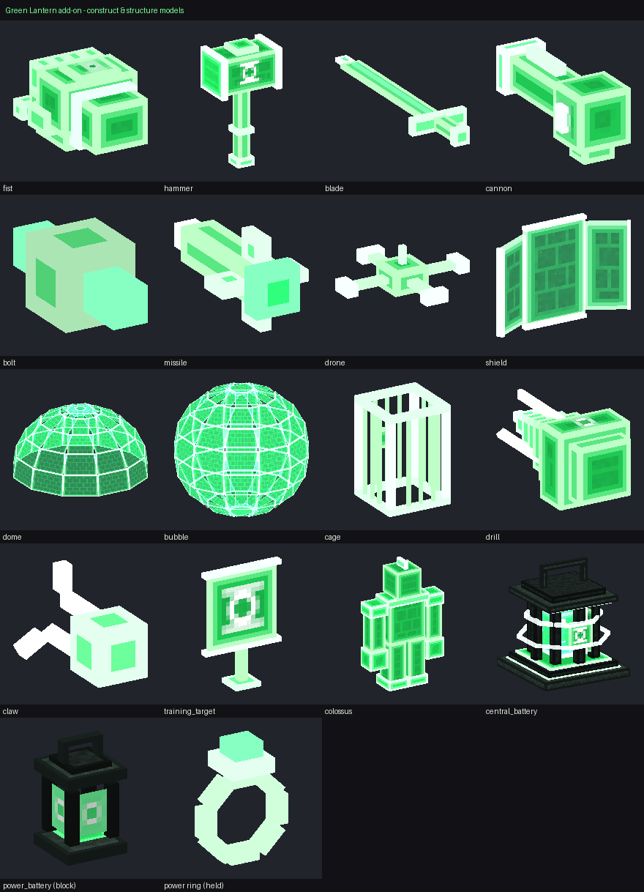

# Green Lantern Corps — Minecraft Bedrock Add-On

A fan-made Green Lantern add-on for **Minecraft Bedrock Edition 1.26.10 or newer**, designed for touch
screens first (menus, buttons and HUD sized for an iPhone 14 Pro Max) and built on the same
cross-platform Bedrock features on every device.

Craft a Power Ring, **type the Green Lantern oath** to activate it, then fly, shape 21 hard-light
constructs from willpower, recharge at Power Batteries, rise through five ranks and fight beside
Hal Jordan, John Stewart, Guy Gardner and Kyle Rayner.

> **Unofficial fan project.** Not affiliated with, endorsed by or connected to DC, Warner Bros.
> Discovery, Mojang Studios or Microsoft. All character names belong to their respective owners.
> Every model, texture, sound and script in this add-on was made from scratch for this project.



## Download

| File | What it is |
| --- | --- |
| [`dist/GreenLantern-v1.0.0.mcaddon`](dist/GreenLantern-v1.0.0.mcaddon) | **Install this.** Behavior pack + resource pack in one file. |
| `dist/GreenLantern-v1.0.0-GreenLanternBP.mcpack` / `-GreenLanternRP.mcpack` | The same two packs as separate files. |
| `dist/GreenLantern-v0.9.0-preview.mcaddon` | Earlier backup build, kept on purpose. |

Step-by-step iPhone instructions: **[docs/INSTALL_IPHONE.md](docs/INSTALL_IPHONE.md)**.
No experimental toggles are needed: the add-on only uses stable Script API modules
(`@minecraft/server` 2.6.0, `@minecraft/server-ui` 2.0.0).

## Quick start

1. Import the `.mcaddon`, then activate the **Green Lantern Corps (Behavior)** pack on a world
   (its resource pack is added automatically).
2. Craft a **Power Ring**: emerald on top, gold ingot – eye of ender – gold ingot in the middle,
   gold ingot at the bottom centre.
3. Hold the ring and tap **Use Ring**. A text box opens: **type the oath** and tap **Submit**.
4. Tap Use Ring to fire your selected construct. **Sneak + Use Ring** opens the ring menu.
5. **Double-tap jump** to fly. Recharge at a **Power Battery**; craft a **Central Power Battery**
   to ascend in rank.

Everything is explained in the **[Player Guide](docs/PLAYER_GUIDE.md)**.

## Features

- **Power Ring** – custom 3D held model, icon and glow; activation, power down/up, recharge;
  energy with overcharge; HUD energy bar; low-energy and cooldown feedback; touch-sized menus.
- **Typed oath** – a real text field with case- and spacing-tolerant checking, clear feedback on
  the first wrong word, an emerald ceremony, and no duplicate rewards when you recite it again.
  The oath text lives in one file you can edit (`scripts/oath_config.js`).
- **21 constructs** in four groups – offense (beam, fist, blade, hammer, cannon, homing missiles,
  drones), defense (shield, wall, bubble, dome), utility (platform, bridge, grapple, cage, drill)
  and advanced (giant fist, titan hammer, willpower lance, aegis dome, emerald colossus). Each has
  its own model or block structure, behaviour, particles, sound, cost and cooldown.
- **Flight** – double-tap jump, joystick steering in the direction you look, hover, climb and dive,
  three speed tiers, energy drain, fall protection, emerald trail and a superhero pose.
- **Power Batteries** – a placeable lantern block for personal recharges and a Central Power
  Battery for full recharges, rank ascension, construct training, a uniform locker and allies.
- **Progression** – willpower (XP) from fights, training and recharges; five ranks that raise
  energy, regeneration, flight speed and unlock constructs; everything saved per player.
- **Lanterns** – Hal Jordan, John Stewart, Guy Gardner and Kyle Rayner as summonable AI allies with
  their own models, skins, animations and signature constructs; Sinestro as a neutral rival.
  Six wearable uniforms with perks.
- **Corps foundation** – energy colours, textures and logic are keyed by Corps. Green is complete;
  yellow is used by Sinestro and his uniform; the other Corps are listed but intentionally inactive.

Honest status of every feature and the known limits: **[docs/FEATURES_AND_LIMITATIONS.md](docs/FEATURES_AND_LIMITATIONS.md)**.

## Testing status

The add-on was checked with automated tools only — **it has not been run inside Minecraft** by the
author of this build:

- every JSON file parses and every model, texture, animation, render controller, sound, particle,
  item, block, recipe and script reference resolves (`tools/validate.py`);
- entities, items, blocks and particles pass Mojang's official JSON schemas (`tools/schema_check.py`);
- all scripts type-check against the exact `@minecraft/server` 2.6.0 / `server-ui` 2.0.0 typings;
- 67 end-to-end gameplay tests run the real scripts against a simulated game API
  (`tools/tests/run_tests.mjs`).

Visual results (model placement, animation feel, flight handling) still need an in-game check; the
limitations document lists exactly what is unverified.

## Repository layout

```
green-lantern-addon/
├── dist/                    packaged .mcaddon / .mcpack builds (older builds are kept)
├── packs/
│   ├── GreenLanternBP/      behavior pack: entities, items, blocks, recipes, scripts
│   └── GreenLanternRP/      resource pack: models, textures, animations, particles, sounds
├── docs/                    install guide, player guide, features & limitations, developer guide
│   └── previews/            contact sheets of models, characters and icons
└── tools/                   asset generators, build, validation, packaging and tests
```

The packs are generated by `tools/build.py` from the sources in `tools/`, except the gameplay
scripts in `packs/GreenLanternBP/scripts/`, which are written by hand. See the
**[Developer Guide](docs/DEVELOPER_GUIDE.md)** to rebuild, test or extend the add-on.
